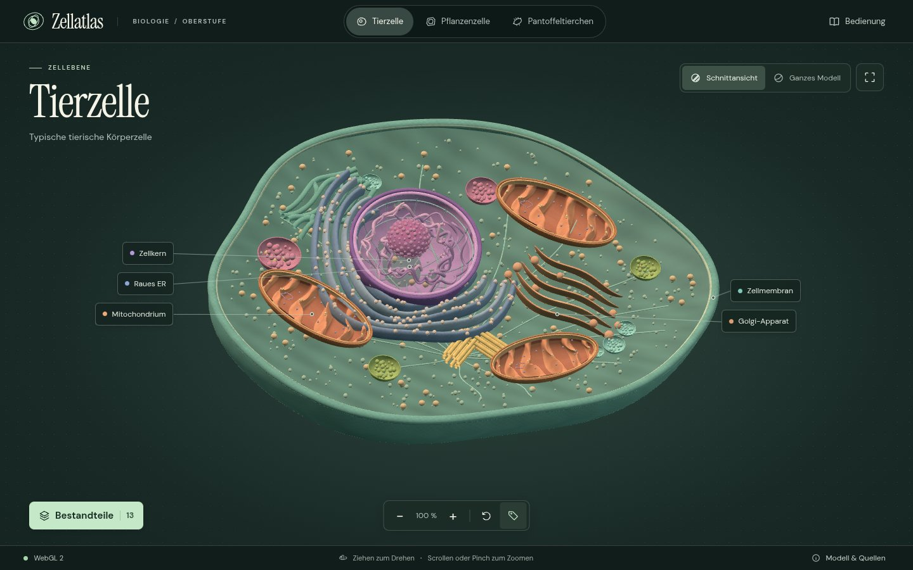

# Zellatlas · Interaktives 3D-Zellmodell

Tierzelle, chloroplastenhaltige Blattzelle und Pantoffeltierchen für den Biologieunterricht der Oberstufe. Eine Struktur im Modell oder im Verzeichnis auswählen, **Organell untersuchen** öffnen und einen Bestandteil als **Feinbau** isolieren. Über dem Modell führt der Pfad wieder zur Zelle.



## Herunterladen und starten

| Verwendung | Paket | Start |
| --- | --- | --- |
| Desktop, auch ohne Internet | [Desktop-ZIP herunterladen](https://github.com/Feerson1617/Zellmodell/raw/refs/heads/feature/zellmodell-3d-atlas/downloads/Zellatlas-Desktop.zip) | Entpacken und **Zellatlas.html** öffnen. Der Ordner **Sichtpruefung** enthält Vergleichsbilder und Bedienprüfungen. |
| itslearning / SCORM 1.2 | [SCORM-ZIP herunterladen](https://github.com/Feerson1617/Zellmodell/raw/refs/heads/feature/zellmodell-3d-atlas/downloads/Zellatlas-SCORM12.zip) | Das ZIP als SCORM-Lernpaket importieren. Alle Inhalte, Schriften und Modelle sind enthalten. |
| Website | [Startdatei](index.html) | Das Repository als statische Website ausliefern oder im Projektordner `python3 -m http.server 8765 --bind 127.0.0.1` starten. |
| Einzeldatei | [Eigenständige HTML-Version](standalone/Zellmodell_3D_eine_Datei.html) | Lokal speichern und in einem WebGL-2-fähigen Browser öffnen. |

Die aktiven Ansichten und Einstellungen gelten für die Sitzung. Der SCO ruft nur `LMSInitialize` und `LMSFinish` auf. Welche Zugriffsprotokolle ein Schul-LMS selbst führt, richtet sich nach dessen Konfiguration.

## Bedienung

- Ziehen oder Pfeiltasten drehen das Modell. Mausrad, Pinch und +/− ändern den Zoom. Pos1 oder der Rückstellpfeil stellen die Kamera zurück.
- Antippen oder Anklicken öffnet die Erklärung. Im Verzeichnis schaltet das Auge alle Exemplare einer Struktur. „Auswahl fokussieren“ zentriert die Kamera auf das gewählte Merkmal.
- Schnittansicht öffnet die Hüllen. Ganzes Modell zeigt die Außenseite. Das Etikettensymbol schaltet die Beschriftungen. Das Vollbildsymbol erscheint bei verfügbarer Browser-Unterstützung.
- Der Ebenenwechsel durch Zoom ist in **Bedienung** zuschaltbar. Eine Auswahl und weiteres Hineinzoomen über 260 % öffnen die Detailansicht. Unter 61 % führt weiteres Herauszoomen zurück.
- **Modell & Quellen** enthält Modellgrenzen, die Endosymbiontentheorie und Literatur. Bei fehlendem WebGL 2 stehen die gekennzeichneten Schemata des Prototyps und das Textverzeichnis zur Verfügung.

## Entwicklung und Prüfung

Die Anwendung verwendet lokal eingebundenes Three.js und prozedurale Geometrien. Der Start benötigt weder Installation noch Build. Änderungen gehören in `index.html`, `style.css`, `biology.js`, `models.js`, `view.js` und `app.js`. Der Build erzeugt die Einzeldatei sowie beide ZIPs aus denselben Quellen.

```sh
python3 scripts/build.py
python3 scripts/check_packages.py
```

Für die Browserprüfung Python-Playwright installieren und `python3 -m playwright install --with-deps chromium` ausführen. `python3 scripts/browser_check.py` startet einen kurzlebigen lokalen Server und prüft auch die Startdateien aus den ZIPs. Mit `--evidence` aktualisiert die Prüfung die Bilder und das Protokoll. Anschließend die Pakete neu bauen. GitHub Actions führt Build, Paket- und Browserprüfung aus und stellt die ZIPs als Artefakt bereit.

[Funktionsvergleich, fachliche Prüfung und Lizenzen](docs/ENTWICKLUNG.md) · [Prüfbericht mit Vergleichsbildern](docs/PRUEFBERICHT.md) · [Entwicklungsauftrag](docs/CODEX_AUFTRAG.md)
