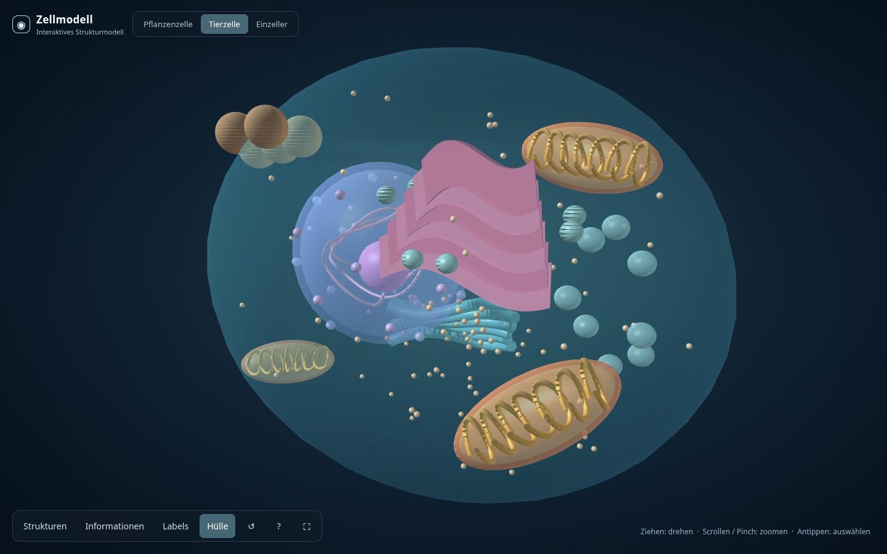
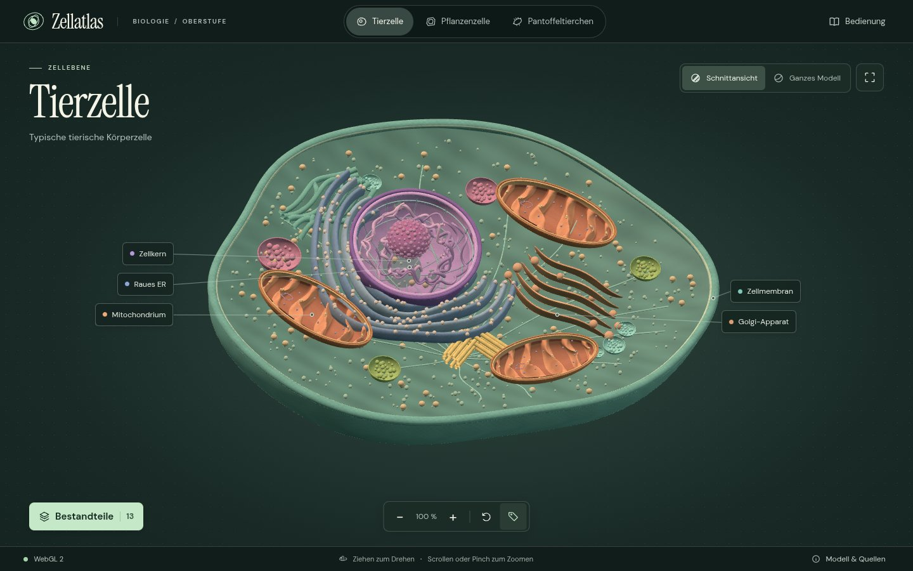

# Prüfbericht · 19. November 2026

Die sechs Hauptansichten wurden in Chromium 156 unter Linux gerendert, als Bildschirmbilder erfasst und visuell geprüft. Der aktive Kontext meldete WebGL 2.0 über ANGLE/Vulkan mit SwiftShader. Die Bildberechnung erfolgte in Software. Der Test prüfte auch, dass der Renderer tatsächlich Geometrie zeichnet. Bei 1440 × 900 Pixeln steht dem Modell mit geschlossenem Informationsbereich rund 88 % der Bildschirmfläche zur Verfügung. Das bezeichnet die nutzbare Zeichenfläche. Die Silhouette ist abhängig von Zellform, Orientierung und Zoom.

| Prototyp 0.2 | Neuer Stand |
| --- | --- |
|  |  |

Im Prototyp liegen die Cristae als einzelne Schleifen innerhalb transparenter Ellipsoide. Die neue Schnittansicht zeigt gefaltete Membranflächen und einen sichtbaren Schnittrand. Der Zellkern ist über das Strukturverzeichnis bis zum Nucleolus untersuchbar. Bei der Pflanzenzelle lassen sich Thylakoidstapel und verbindende Lamellen isolieren. Bei Paramecium sind die bewimperte Oberfläche und die Sammelräume der kontraktilen Vakuolen voneinander unterscheidbar.

| Zellansichten | Organellansichten |
| --- | --- |
| [Tierzelle](pruefung/tierzelle.jpg) | [Zellkern](pruefung/zellkern.jpg) |
| [Pflanzenzelle](pruefung/pflanzenzelle.jpg) | [Mitochondrium](pruefung/mitochondrium.jpg) |
| [Pantoffeltierchen](pruefung/pantoffeltierchen.jpg) | [Chloroplast](pruefung/chloroplast.jpg) |

## Prüfergebnisse

| Prüfung | Ausführung und Ergebnis |
| --- | --- |
| Desktop | Zwölf Prüfgruppen in Chromium erfolgreich. Zellwechsel, Auswahl über Geometrie und Liste, Highlight und Kamerafokus, Zoom, Reset, Tastatur, Vollbild und beide Zurückwege ausgeübt. Schnitt und ganze Hülle sowie Rotation und Sichtbarkeit per Bildvergleich unterschieden. [Laufprotokoll](pruefung/browser.json) |
| Ebenen und Inhalt | Alle angebotenen Zellstrukturen und ihre Feinstrukturen haben zugeordnete Geometrie und Text. Kern, Mitochondrium und Chloroplast wurden jeweils bis zu einem isolierten Teil und zurück durchlaufen. Zoom-Wechsel aus und an sowie Modellgrenzen und Endosymbiontentheorie geprüft. [Geöffnetes Infopanel](pruefung/zellkern-information.jpg) |
| Tablet | Chromium mit Touch-Eingabe und iPad-typischen Viewports 1180 × 820 und 820 × 1180 CSS-Pixel. Einfingerziehen verändert die Projektion, Pinch den Zoom, Tippen öffnet Informationen. Panel im Hochformat unter der Zeichenfläche. [Querformat](pruefung/tablet-quer.jpg) · [Hochformat](pruefung/tablet-hoch.jpg) |
| Desktop-ZIP im Dateisystem | Aus dem ZIP entpacktes HTML in Firefox 153 auf einem virtuellen Linux-Bildschirm mit ausgeschaltetem Browsernetz über `file:` geöffnet. WebGL 2 aktiv, Wechsel zur Pflanzenzelle und Detailansicht des Chloroplasten erfolgreich. [Firefox-Protokoll](pruefung/dateistart-firefox.json) |
| Zweiter Dateitest | Linux-WebKit 26.5 öffnete dieselbe ZIP-Startdatei mit blockierten HTTP(S)-Anfragen und aktivem WebGL 2. Die eingebaute Offline-Emulation dieses Testbrowsers verweigerte bereits eine minimale lokale HTML-Datei, daher wurde für diesen Lauf das Netz über die Browser-Routen gesperrt. [WebKit-Protokoll](pruefung/dateistart-webkit.json) |
| SCORM | Manifest im ZIP-Stamm gegen die mitgelieferten XSD-Dateien validiert. Organisation, Item, SCO und Startdatei verknüpft. Chromium startete die gepackte Seite im Frame eines simulierten SCORM-1.2-LMS und wechselte die Zelle. Beim Verlassen genau ein `LMSFinish("")` nach einem `LMSInitialize("")`. Cookies und Web Storage am Prüfpunkt leer. |
| Offline und Ersatzmodus | Die gepackten Startdokumente liefen in Chromium bei gesperrten Zusatzanfragen. Keine weiteren Ressourcenanforderungen oder Seitenfehler. Ohne WebGL 2 erschien das gekennzeichnete Zell-Schema mit benutzbarem Verzeichnis. Im kopflosen Firefox ohne Display war ebenfalls der Ersatzmodus aktiv. |
| Build | Zwei unmittelbar aufeinanderfolgende Builds lieferten bytegleiche ZIPs. Archivintegrität, Äquivalenz von Einzeldatei und Desktop-Dokument sowie die Ressourcenverweise des Manifests wurden geprüft. |

## Reproduktion

```sh
python3 scripts/build.py
python3 scripts/check_packages.py
python3 scripts/browser_check.py
```

Der Browserlauf benötigt die Python-Bindings von Playwright und Chromium. Für neue Referenzbilder `python3 scripts/browser_check.py --evidence` ausführen und die Pakete anschließend erneut bauen. Die Einzeldateiprüfung ist mit `python3 scripts/file_check.py --engine firefox --headed` und `python3 scripts/file_check.py --engine webkit` wiederholbar, wenn die jeweiligen Playwright-Browser und Systembibliotheken installiert sind.

## Grenzen der Abnahme

iPad-Größen und Mehrfinger-Eingaben wurden emuliert. Leistung, Speichergrenzen, Vollbildverhalten und Bediengefühl auf Schul-iPads mit Safari erfordern einen Gerätetest. Der SCORM-Test verwendete ein lokales LMS-Testfenster. Der Import in die konkrete itslearning-Installation und deren eigene Protokollierung bleiben vor Ort zu prüfen. Die Anwendung selbst übermittelt keine Leistungs-, Fortschritts- oder personenbezogenen Daten. Eine Unterrichtserprobung mit Lernenden steht aus. [Anleitung für die Sichtprüfung](Sichtpruefung.txt)
